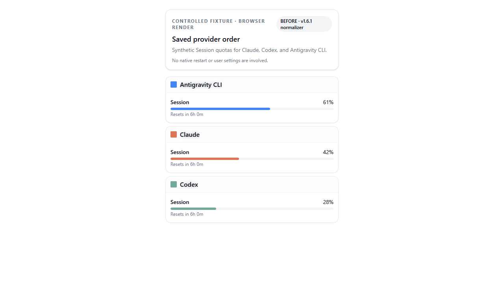
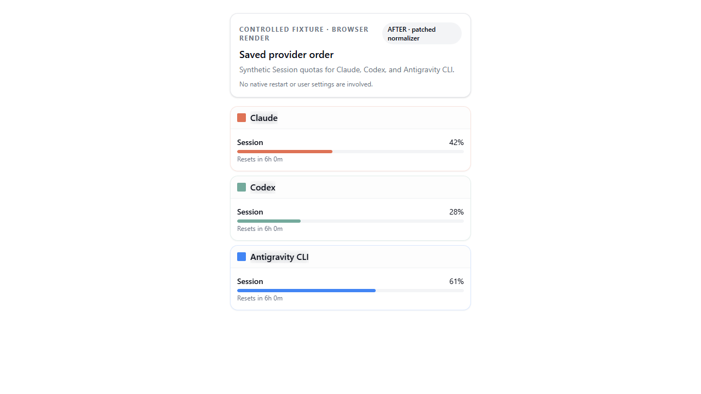

# CrossUsage provider-order visual evidence

This scratch harness renders the project's real `WidgetGroupedList` and calls its real `buildProviderWidgetGroups` and `normalizePluginSettings` functions. The fixture uses Claude, Codex, and Antigravity CLI with fixed synthetic Session values (42%, 28%, and 61%). It reads no native app state, credentials, or user settings.

The before view imports `normalizePluginSettings` extracted from `v1.6.1:src/lib/settings.ts`. The after view imports the current repository's `src/lib/settings.ts`. Both results pass through the same grouping and card-rendering components. The screenshot labels identify the controlled browser fixture; they do not represent a native restart test.

## Reproduce

From the repository root on this evidence branch, install the locked dependencies and start the fixture:

```powershell
bun install --frozen-lockfile
.\evidence\provider-order\prepare.ps1
```

Keep the Vite process open. In a second PowerShell window from the repository root, use the Playwright CLI:

```powershell
npx --yes --package @playwright/cli playwright-cli --session crossusage-order open http://127.0.0.1:4317/?mode=before
npx --yes --package @playwright/cli playwright-cli --session crossusage-order snapshot
npx --yes --package @playwright/cli playwright-cli --session crossusage-order eval "window.__FIXTURE__"
npx --yes --package @playwright/cli playwright-cli --session crossusage-order eval "Array.from(document.querySelectorAll('h3')).map((h) => h.textContent)"
npx --yes --package @playwright/cli playwright-cli --session crossusage-order console
npx --yes --package @playwright/cli playwright-cli --session crossusage-order screenshot --filename <output-dir>/crossusage-order-before.png --full-page

npx --yes --package @playwright/cli playwright-cli --session crossusage-order open http://127.0.0.1:4317/?mode=after
npx --yes --package @playwright/cli playwright-cli --session crossusage-order snapshot
npx --yes --package @playwright/cli playwright-cli --session crossusage-order eval "window.__FIXTURE__"
npx --yes --package @playwright/cli playwright-cli --session crossusage-order eval "Array.from(document.querySelectorAll('h3')).map((h) => h.textContent)"
npx --yes --package @playwright/cli playwright-cli --session crossusage-order console
npx --yes --package @playwright/cli playwright-cli --session crossusage-order screenshot --filename <output-dir>/crossusage-order-after.png --full-page
```

The reproduction uses the repository's installed Bun/Vite/React dependencies and requires the `v1.6.1` Git tag.

## Captured results

The saved order is `claude, codex, antigravity-cli` on both pages. Playwright inspected the fixture state and actual `h3` headings:

| Version | Normalized and rendered order | Console errors / warnings |
| --- | --- | --- |
| v1.6.1 | Antigravity CLI, Claude, Codex | 0 / 0 |
| Patched | Claude, Codex, Antigravity CLI | 0 / 0 |

| Before | After |
| --- | --- |
|  |  |
